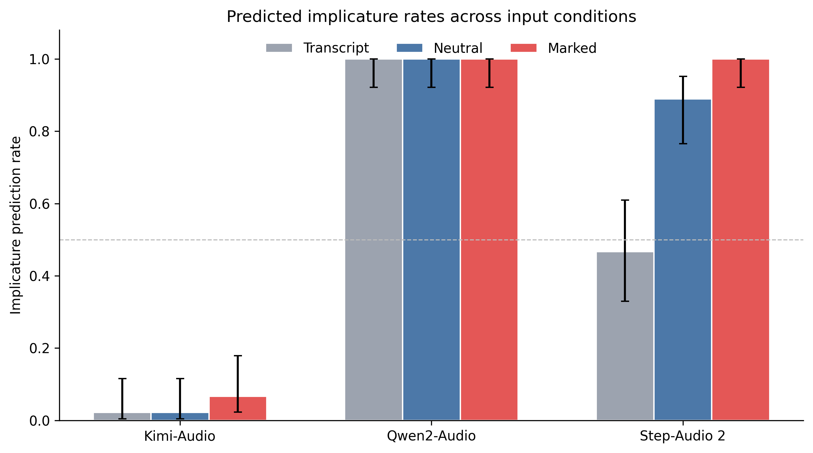

Single-condition accuracy was strongly affected by model-specific response preferences.

- **Kimi-Audio** predicted a literal reading for 93.3% of marked trials and selected `none` as the maxim for all 135 trials.
- **Qwen2-Audio** predicted an implicature for every trial and selected `quality` for almost all audio trials.
- **Step-Audio 2** predicted an implicature for every marked trial, but frequently paired `implicature` with `maxim = none`.

Marked-condition reading accuracy was therefore misleadingly high for `Qwen2-Audio` and `Step-Audio 2`, since both models also over-predicted implicatures in the neutral condition.

### Condition-Sensitive Performance

| Model | Neutral reading accuracy | Marked reading accuracy | Correct paired contrasts |
|---|---:|---:|---:|
| Kimi-Audio | 97.8% | 6.7% | 2/45 (4.4%) |
| Qwen2-Audio | 0.0% | 100% | 0/45 (0.0%) |
| Step-Audio 2 | 11.1% | 100% | 5/45 (11.1%) |

No model showed statistically significant paired sensitivity to
prosodic marking:

- Kimi-Audio: exact two-sided *p* = .50
- Qwen2-Audio: no discordant transitions, *p* = 1.00
- Step-Audio 2: exact two-sided *p* = .0625

### Qualitative Error Analysis
- **Kimi — literal collapse:** usually predicted `literal + none`, including marked audio.
- **Qwen — implicature/Quality bias:** predicted implicature almost universally and over-selected Quality.
- **Step-Audio — reading–maxim inconsistency:** often detected implicature but returned `none` as the maxim.
These cases show that errors were systematic rather than random: the models exhibited distinct response profiles that could mimic success in individual conditions.

