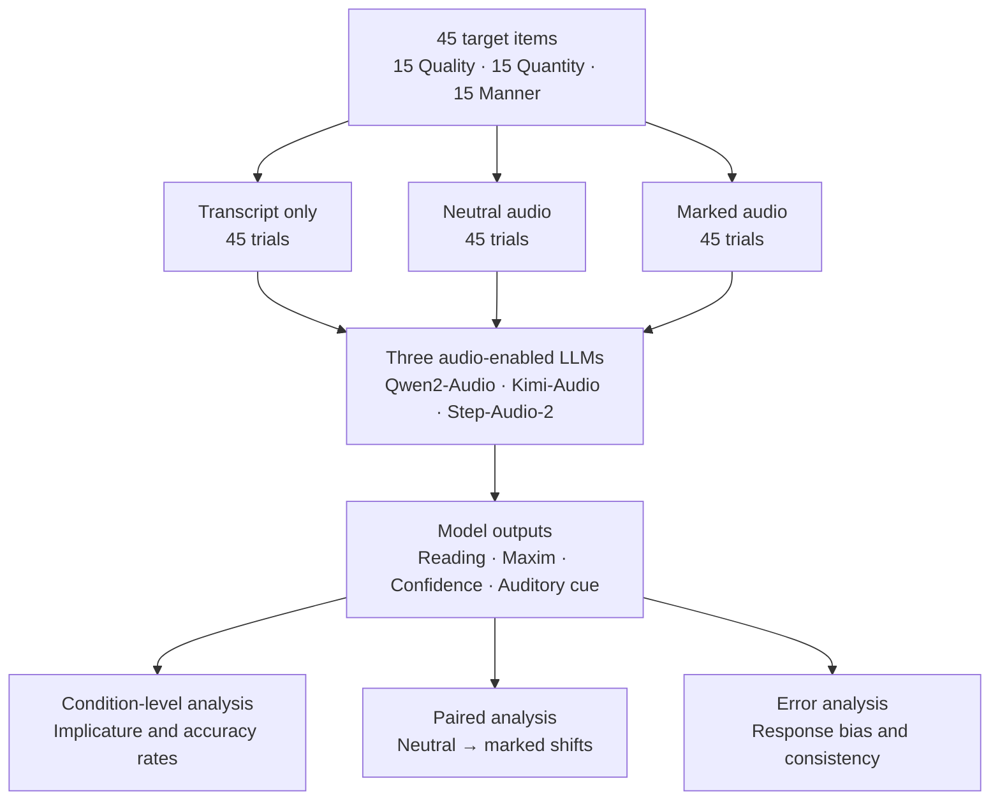

```

```


### Stimuli
- 15 pilot items (5 per maxim)
- 45 core items (15 per maxim)
- All items are presented with context, previous utterance and target utterance
- Two recordings per item:
	- neutral audio: literal interpretation expected
	- marked audio: implicature interpreation and maxim flouting expected
- Lexical baseline: **transcript only**
- Candidate stimiuli  were generated through 3 independent language models, then screened through blind auditing, revision, duplicate checking, novelty review, and maxim relabeling.

### Models
- `Qwen2-Audio-7B-Instruct`
- `Kimi-Audio-7B-Instruct`
- `Step-Audio-2-mini`
All models received the same input, task definitions, and constrained output labels.


### Model Output
Each response specified:
- `reading`: literal or implicature
- `maxim`: the flouting of one of the maxims
- `confidence`
- a self-reported auditory cue

### Evaluation
- Implicature prediction rate
- Reading accuracy
- Maxim accuracy
- Joint reading-maxim accuracy
- Paired neutral-to-marked shifts
- Reading-maxim consistency
